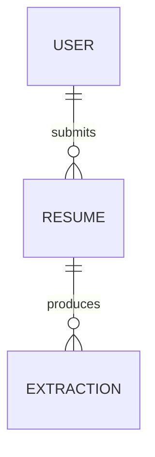

# 数据模型与数据生命周期

| 项 | 值 |
|---|---|
| 版本 | v0.1 |
| 最后更新 | <YYYY-MM-DD> |

> 本文件是**数据唯一源**。schema 变更必须先改这里 + 写 ADR（若不可逆），再写迁移。

## 一、实体关系

## 二、表定义

### `<table_name>`

| 字段 | 类型 | 可空 | 默认 | 约束 / 索引 | **数据分级** | 说明 |
|---|---|---|---|---|---|---|
| `id` | `uuid` | 否 | `gen_random_uuid()` | PK | 内部 | 主键 |
| `user_id` | `uuid` | 否 | — | FK → user.id, index | 内部 | 归属 |
| `phone` | `varchar(20)` | 是 | — | unique(index) | **PII-敏感** | 加密存储；**禁止入日志** |
| `created_at` | `timestamptz` | 否 | `now()` | index | 内部 | **一律 UTC 存储** |
| `deleted_at` | `timestamptz` | 是 | — | index | 内部 | 软删除标记 |
| `amount_cents` | `bigint` | 否 | 0 | ≥ 0 | 机密 | **金额用整数分，禁止 float** |

**数据分级取值**：公开 / 内部 / 机密 / **PII**（个人敏感信息）。
凡标记 PII 的字段，必须同时满足：加密存储（或列级加密）、日志与埋点脱敏、导出受控、有保留期、纳入删除权实现。

## 三、迁移策略

- [ ] 所有结构变更走**版本化迁移文件**，已执行过的迁移文件**永不修改**
- [ ] 禁止手工改生产库结构；紧急修复也必须补一条迁移
- [ ] 采用 **expand → migrate → contract**：先加新列（可空）→ 双写/回填 → 切换读取 → 再删旧列
- [ ] 每个迁移必须说明：**是否可回滚**；不可回滚的，写明前向修复方案
- [ ] 大表加列/加索引用并发方式（`CREATE INDEX CONCURRENTLY`），避免锁表
- [ ] 迁移在 staging 演练通过后才允许进 prod
- [ ] 回填脚本必须**可中断可重入**，并记录进度

| 迁移文件 | 内容 | 可回滚 | 演练日期 | 备注 |
|---|---|---|---|---|
| `<timestamp>_add_xxx` | <…> | 是 / 否（<修复方案>） | <YYYY-MM-DD> | <…> |

## 四、备份与恢复

| 项 | 值 |
|---|---|
| 备份频率 | <每日全量 + 持续增量> |
| 保留 | <30 天> |
| 异地副本 | <是 / 否，位置> |
| **RTO / RPO** | RTO ≤ <1>h，RPO ≤ <15>min（与 `PRD.md` 第 7 节一致） |
| 恢复演练 | **每季度至少一次真实恢复**，记录见下表 |

| 演练日期 | 恢复点 | 实际耗时 | 数据丢失量 | 结论 / 改进 |
|---|---|---|---|---|
| <YYYY-MM-DD> | <…> | <…> | <…> | <…> |

## 五、保留与销毁

| 数据类别 | 保留期 | 到期动作 | 执行方式 | 验证 |
|---|---|---|---|---|
| <简历原件> | <90 天> | 物理删除 | <定时任务 `purge-resumes`> | <月度核对行数> |
| <审计日志> | <3 年> | 归档至冷存储 | <归档任务> | <季度核对> |
| <用户账号> | 用户注销后 <30> 天 | 匿名化 + 删除 PII | <注销流程> | <抽样验证> |

## 六、性能与容量

- 慢查询预算：P95 < <100>ms；超过则加索引或改查询，并登记到 `CONSTRAINTS.md` 棘轮表
- 容量与增长率：<首年行数 / 存储量 / 增长率>
- 热点与分页：<分页键；禁止 offset 深翻页>
